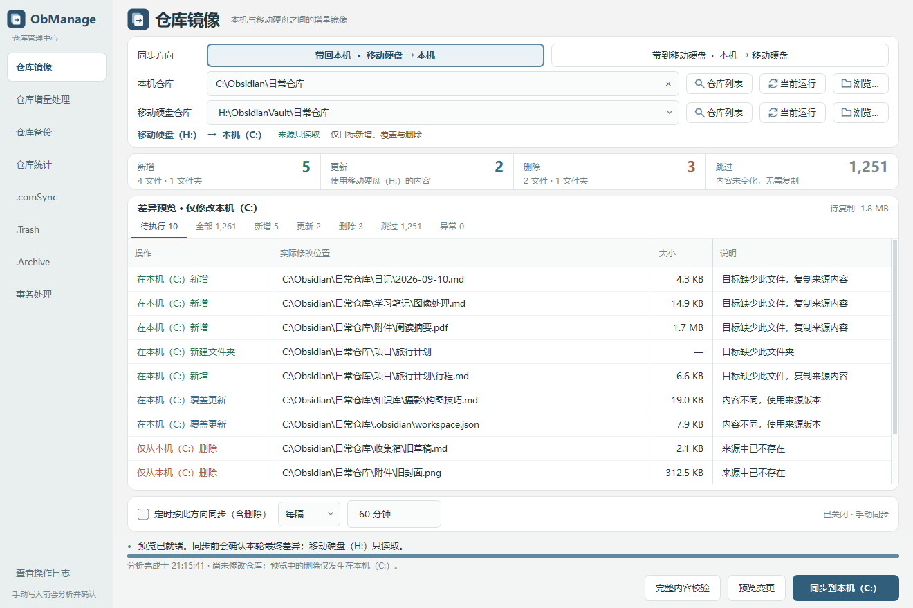
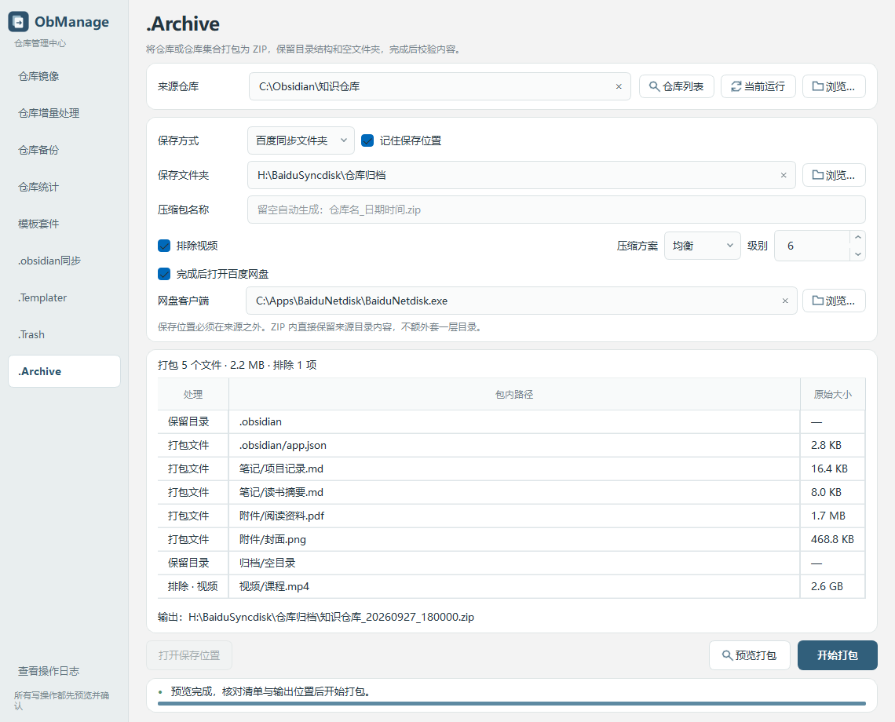
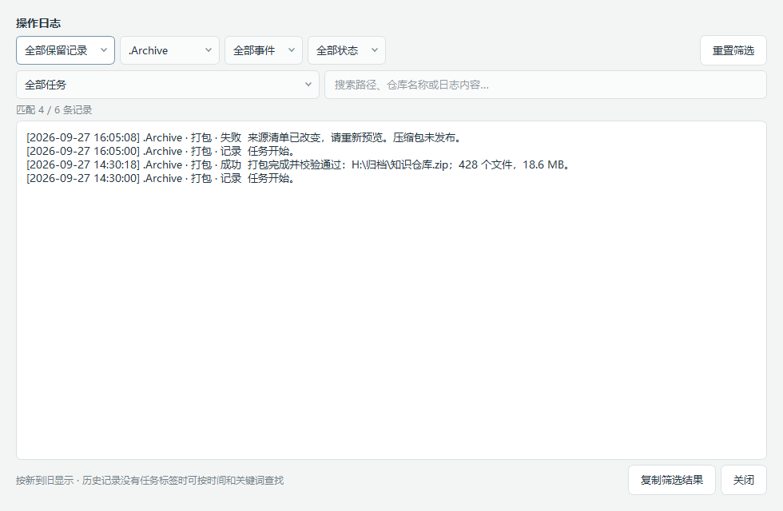
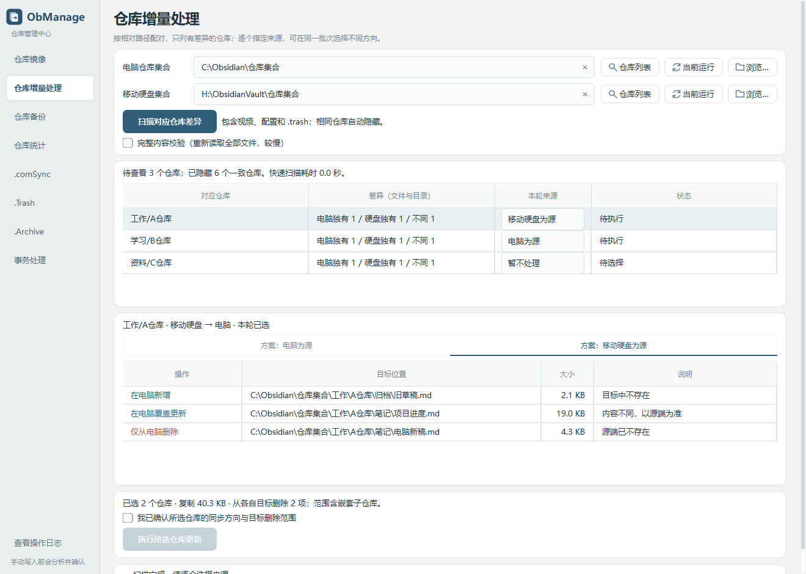
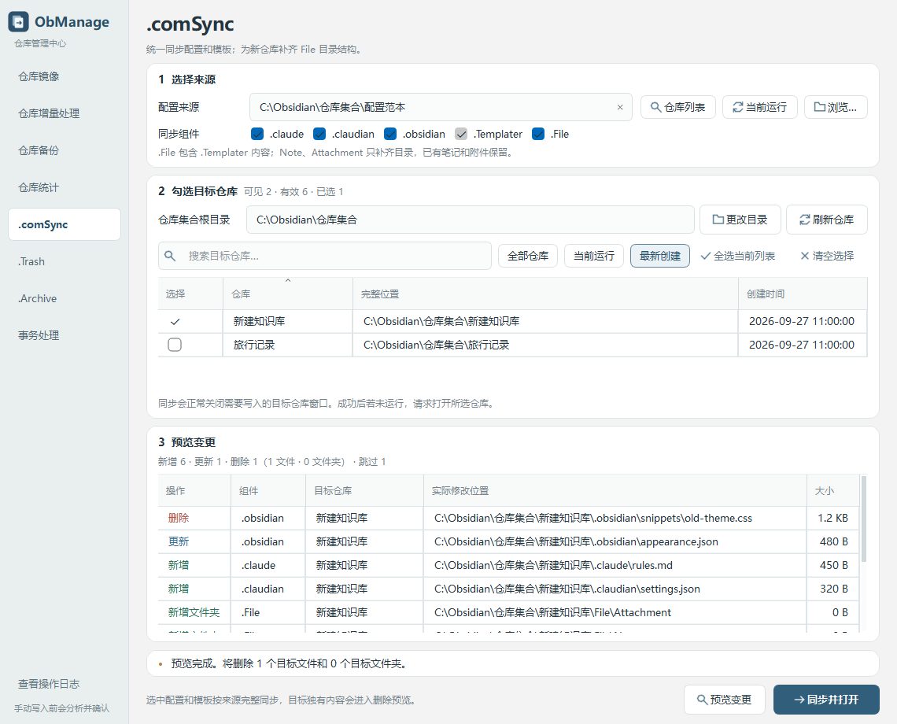

# ObManage

**一个窗口，安全管理 Windows 上的一组 Obsidian 仓库。**

ObManage 2.8 把仓库镜像、逐仓库增量处理、无视频仓库备份、仓库统计、配置与模板分发、回收站清理、ZIP 归档和事务处理统一成八个独立页面；手动同步先分析实际差异，再按本轮方向、目标及删除范围确认写入。

整个过程在本地完成，无须云账号。设置、部署备份、事务记录和日志集中保存在本机应用数据目录，与仓库分离。

2.8.4 增加首次复制实验工具和独立的全文件 SHA-256 核验。实验默认只读，真实复制按本轮预览逐批确认，详见[真实首次同步实验](docs/2.8.4-真实首次同步实验与性能优化.md)。

2.8.3 加快仓库发现和只读统计中的 Windows 目录查询，仓库列表仍会在本轮核验后应用历史点选。USB/exFAT 与本机 NVMe 的结果分别记录在[真实介质扫描验收](docs/2.8.3-真实介质扫描诊断与性能验收.md)。

2.8.1 中，仓库增量扫描发现阻断整批的问题时，会显示问题路径和“扫描不完整”，并提前结束。本轮也减少了统计和增量的重复元数据查询。正常增量扫描仍在结束时实时复核两端。实测范围见[扫描架构与性能优化](docs/扫描架构与性能优化.md)。

仓库镜像、无视频备份和 `.comSync` 可从同步按钮直接开始准备并确认。本机镜像或无视频备份可独立查看分析结果；`.comSync` 支持按仓库范围筛选，正常关闭确实需要写入的目标窗口并在收尾时恢复原有会话。

“确认完成”会保留当前仓库、结束所选部署，再一次清除全部可清理事务的副本和记录。副本已删除但仍保留路径的历史记录也一起移除；清理后列表和路径详情随即清空，失败项保留记录供重试。

2.5.2 优化小文件同步、反向校验记录复用和 ZIP 归档预览，保留完整内容校验与原压缩等级；优化自动生效，无须按电脑性能选择模式。实测范围和复现方式见[性能验证](docs/性能验证.md)。



*截图使用隔离的演示数据，不包含真实仓库内容。*

## 八个页面

| 页面 | 用途 | 是否写入仓库 |
| --- | --- | --- |
| 仓库镜像 | 在本机与移动硬盘之间做单向增量镜像 | 仅写入本轮目标 |
| 仓库增量处理 | 列出两端有差异的对应仓库，逐个选择电脑或移动硬盘为源 | 仅写入各仓库所选方向的目标 |
| 仓库备份 | 在笔记本与移动硬盘之间同步除视频外的仓库内容 | 仅写入本轮目标的非视频内容；两端视频保持原样 |
| 仓库统计 | 统计总容量、全部文件、文件类型、Markdown 和 UTF-8 字符 | 否，全程只读 |
| .comSync | 统一同步 `.claude`、`.claudian`、`.obsidian`、`.Templater` 和 `.File`；可按全部、当前运行、最新创建筛选目标 | 配置与模板完整同步；Note、Attachment 只补齐目录，已有内容保留 |
| .Trash | 预览并直接清理仓库根目录下的 `.trash` | 仅移除扫描后选中且已预览的内容 |
| .Archive | 把仓库或集合打包为 ZIP，可排除视频、调整压缩级别并联动百度网盘 | 来源只读，仅创建选定位置的新压缩包 |
| 事务处理 | 一个列表管理全部事务；检查、结束、恢复，以及一并清除副本和记录 | 恢复修改原授权子树；清除仅涉及事务副本和记录 |

左侧导航固定把“仓库镜像”放在第一页。所有页面共享一个后台任务槽。若镜像定时任务到点时其他任务正忙，本轮会跳过。事务待处理或记录无法核验时，新的仓库写入和定时镜像暂停。请从“事务处理”查看相应记录。

## ZIP 归档与日志筛选

“.Archive”支持自选保存文件夹、记住固定位置，以及可选的百度同步文件夹。压缩级别可选仅打包、速度优先、均衡、体积优先或自定义 0–9；视频排除沿用仓库备份的规则。先预览文件与排除项，再创建 ZIP，保留空目录，完整 SHA-256 校验通过后才发布，不覆盖同名旧包。百度网盘的同步文件夹和客户端都可自行配置，只有开启联动且打包成功后才请求打开客户端，上传状态由网盘管理。



操作日志支持时间范围、功能、事件、单次任务、状态和关键词组合筛选。旧日志仍能按时间和内容查找；新记录包含任务标签，即使切换页面也能准确追踪一次操作。默认展示所有保留记录，匹配超过 2,000 条时显示最新部分并提示缩小筛选范围。



## 安全模型

### 镜像

每次只选择一个方向，以来源为准同步新增、修改和删除。来源只读取，所有变化只发生在目标；目标独有文件也属于删除范围，因此它不是双向合并工具。

普通文件先暂存到目标盘，读取暂存副本完成 SHA-256 校验后再替换；新增或更新失败、取消后不会继续删除。2.1.2 在此前大量小文件优化上继续减少相邻的重复快照；异卷复制以最多一个待处理文件形成“下一文件暂存 / 当前文件写后校验”流水线，同卷仍串行避免机械盘寻道竞争。没有删除项时只做一次最终全树屏障，不重复扫描完全相同的终态；所有逐文件路径链、来源/目标快照、完整写后 SHA-256 和删除前后屏障仍保留。程序拒绝源目标相同、互相包含、目标为盘根、链接或重解析点越界，并在执行前复核路径、磁盘身份和预览是否仍有效。空来源可能清空目标时，手动确认会明确标出清空范围；定时遇到此情况会暂停。

### 逐仓库增量处理



适合“A 仓库在移动硬盘上编辑、B 仓库在电脑上编辑”的情况：选择两端仓库集合目录，扫描后只显示有差异或异常的仓库，完全一致的仓库自动隐藏。按集合内的相对路径配对，例如两端的 `学习/A` 对应；不同目录下同名仓库不会被猜测配对。可以直接选两个对应仓库根目录，此时以 `.` 配对。

每行默认“暂不处理”。你可以将 A 选为“移动硬盘为源”、B 选为“电脑为源”，核对所选方向和删除汇总后确认执行。两种方案的详细差异与完整路径可按需查看。数量少或时间较早的一端也可以作为来源；程序只展示差异，不推断哪一端更新。同一个仓库仍以所选来源为准，目标独有内容会删除，仅处理所选仓库范围（包含其中嵌套子仓库）；这是逐仓库选择方向，不是同一仓库内的文件冲突合并。

扫描覆盖所有普通文件（含视频、`.obsidian` 和 `.trash`）。默认快速扫描复用两端完整快照都未变化的已校验记录，首次或变化文件仍校验内容；一次比较生成双向方案，不重复读取反向内容。需要排查静默损坏或同大小、同元数据的修改时，勾选“完整内容校验”，重新读取内容；首次及完整校验仍可能耗时数分钟。页面显示本轮模式、仓库进度和总耗时。

仅一端存在的仓库可明确选择复制到另一端缺失的位置；如果对应位置已有未识别为仓库的目录，显示异常并拒绝覆盖。嵌套父子仓库可以分别查看，但不能在同批同时选择重叠范围。执行前复核全部所选预览，再串行更新；失败或取消就停止后续仓库，已完成部分保留，须重新扫描。扫描发现无法读取或不安全的集合内容时会明确显示并阻止整批写入。

### 无视频仓库备份

“仓库备份”用于在容量有限的笔记本上保留轻量 Obsidian 仓库。选择“移动硬盘 → 笔记本”时，完整仓库中的 Markdown、图片、音频、PDF、配置和其他非视频文件会同步到笔记本，视频不会复制；选择“笔记本 → 移动硬盘”时，笔记本产生的非视频修改会带回完整仓库，移动硬盘已有视频不会覆盖或删除。

它仍是逐轮单向镜像，不会自动合并两端冲突：非视频目标独有内容属于删除范围，执行前必须核对方向和删除预览。视频按扩展名识别，预览中显示为“排除视频”；来源视频不读取内容、不复制，目标视频不覆盖、不删除，包含被保留视频的目录也不会作为多余空目录删除。完整镜像与无视频备份分别保存校验记录，互不复用。

### 仓库统计

统计会给出全部仓库的文件总数、内容总大小、Markdown 和字符汇总，也会逐仓库列出文件、文件夹与容量。文件类型按扩展名归入 Markdown、Obsidian 画布、图片、视频、音频、PDF、Word、Excel、PowerPoint、电子书、压缩包、代码、数据、文本、字体和其他文件；类型表会同时显示实际出现的扩展名、数量、大小及占比。选中一个或多个仓库时，类型表会切换到所选范围。

统计全程只读。内容总大小是普通文件的逻辑字节总和，不等于 NTFS 实际分配空间；默认排除 `.obsidian`、根级 `.trash`、嵌套子仓库和应用事务目录。关闭字符统计仍会统计全部文件与容量，只是不打开 Markdown 正文，因此适合快速查看仓库构成。

### 配置与模板部署

**.comSync** 将原“.obsidian同步”“模板套件”和“.Templater”合为一个工作台，按“选择来源及组件 → 勾选目标 → 预览并同步”操作。各页面仍提供**仓库列表**、**当前运行**、**浏览**三种仓库选择方式；运行识别核验实际 Obsidian 窗口，同名或无法核验时不猜测路径。

| 组件 | 实际同步范围 |
| --- | --- |
| `.claude` / `.claudian` / `.obsidian` | 对应同名目录的完整内容，目标独有项进入删除预览 |
| `.Templater` | `File/Templater` 完整内容 |
| `.File` | 包含同一份 `File/Templater` 内容；仅补齐 `File/Note`、`File/Attachment` 空目录，不复制来源笔记或附件，保留目标已有内容及其他 File 子目录 |

使用“更改目录”和“刷新仓库”配置集合范围。在目标列表中选择“全部仓库”“当前运行”或“最新创建”，再按需搜索和勾选。最新范围按全部有效候选的目录创建时间计算，并列项同时显示。筛选隐藏的勾选会自动移除，恢复筛选时需要重新选择。



配置与模板使用持久事务，历史批次也可在“事务处理”页恢复。

1. 分析阶段逐文件计算 SHA-256，列出文件与目录的 `新增 / 更新 / 删除 / 跳过`，不创建事务记录，也不写目标。
2. 执行前重新验证来源、目标、父目录和磁盘身份；任一项变化都会拒绝旧预览。
3. 所有目标先在各自目标卷完成完整暂存和校验，任何一个目标预备失败都不会提交其他目标。
4. 提交在目标盘通过目录重命名完成切换。成功后，旧子树经核验集中保存在应用数据目录的 `backups` 文件夹。中途失败会停止后续目标并逆序回滚。
5. 重启后仍可在独立“事务处理”页选择批次。点击“确认完成”，一次确认后保留当前仓库、结束所选事务，并清除本批全部可清理副本和记录；点击“确认回退”，则保全当前内容并恢复同步前子树。

“事务处理”页可查看部署备份目录，并设置自动清理期限。默认关闭，启用后可设 1–36500 天。程序运行时会检查已成功同步或已结束的部署备份，包含回退保全副本。到期删除后无法取回副本或用它回退。升级前遗留的回收站隔离批次仍需单独处理。[使用指南](docs/使用指南.md#部署备份与自动清理)

配置与模板采用完整子树语义（Note、Attachment 只补齐目录）。可只读预览，也可直接点击“同步所选”或“同步并打开”。程序正常关闭需要写入的目标窗口，再读取窗口关闭时保存的配置，并展示最终范围供确认。来源、其他仓库和预检查一致的目标可以继续运行。目标会话无法确认或关闭时，本轮停止。

成功、取消或安全回滚后，程序尝试恢复本轮实际关闭的原有会话，包括多目标任务。“同步并打开”也可请求打开单个原先关闭的目标，即使无需写入。打开需要可按完整路径核验的登记 ID；已运行的仓库不会重复请求。打开请求和数据同步结果分别显示。目标身份改变或仍需恢复事务时，请先查看提示。

### 回收站清理

清理功能只识别真实 Obsidian 仓库根目录的 `.trash`，不会递归删除业务目录中同名的文件夹。扫描会完整列出文件、目录和大小，并默认选中全部非空回收站；可以在确认前取消任意仓库。

勾选“直接删除且无法恢复”的确认后，程序会先完整复核所有所选预览，再按预览逐项删除并保留 `.trash` 目录。新清理不会复制隔离备份，也不会创建回收站 journal 或认证密钥；删除不可撤销。执行期间新出现的项目不属于原预览，不会被顺带删除；权限错误、取消或并发变化可能留下部分清理结果，页面会显示已删除数量并要求重新扫描。

升级前遗留的隔离批次可在“事务处理”页恢复或确认永久清理。处理完成前仍参与全局恢复门禁。

## 开始使用

### 已有便携程序

解压 `dist\ObManage.zip` 后，压缩包根目录就是程序根目录，直接打开其中的 `ObManage.exe`。保留旁边的 `_internal` 文件夹，移动时复制解压后的整个目录；运行便携版无须安装 Python。

仓库镜像的基本流程：

1. 选择本机仓库、移动硬盘仓库和“带走 / 带回”方向。
2. 点击“同步到…”自动分析，也可先单独查看差异。
3. 核对本轮来源、目标和删除范围后确认。

无视频备份的基本流程相同，但固定使用“笔记本轻量仓库”和“移动硬盘完整仓库”两个端点。第一次打开默认把笔记本端指向桌面的 `ObsidianTest`；按实际位置修改后会独立保存。分析后可切到“排除视频”分类核对哪些路径不会被处理。

其他管理页面的基本流程：选择仓库集合根目录和来源，扫描或分析，核对目标、文件与目录预览及删除数量，再执行。分发目标默认不选；回收站扫描后默认选择全部非空项。输入、选择或页面上下文变化后，旧确认都会失效。

详细说明见 [使用指南](docs/使用指南.md)。

### 从源码运行或打包

环境：**Windows x64、Python 3.14（普通 GIL 版本）**。界面使用 PySide6，完整镜像与无视频备份的隔离基线使用 SQLite。依赖版本固定在 requirements 文件中。

```powershell
git clone https://github.com/DewMysimple/ObManage.git
cd ObManage
python -m venv .venv
.\.venv\Scripts\python.exe -m pip install -r requirements-dev.txt
.\.venv\Scripts\python.exe -m obmanage
```

生成便携程序：

```powershell
.\buildStart.cmd
```

脚本从当前源码目录调用 `tools\build.py`，即使从其他工作目录启动也会使用本仓库的 `.venv`。打包前会强制结束当前工作区 `dist\ObManage\ObManage.exe` 的运行进程，正在处理的任务会被中断。产物位于 `dist\ObManage\`，并自动生成 `dist\ObManage.zip`。ZIP 解压后直接得到程序根目录，不会再套一层 `ObManage` 文件夹；Git 源码仓库不跟踪构建产物，下载源码后需执行上述构建步骤才能得到 EXE 和 ZIP。

命令行 `--preview --source ... --target ...` 仍只提供“仓库镜像”的只读差异 JSON；其余功能在桌面界面中使用。

## 镜像的增量校验

首次遇到已有副本时，同路径、同大小文件会做 SHA-256 内容比较：内容相同就跳过复制并记录两端状态。后续分析可用每端大小与精确修改时间快速判断；任一边发生变化才重新比较。

“完整内容校验”会绕过快速记录，重新读取两端每个文件并做 SHA-256。本机与移动盘位于不同卷时，两端会并行读取；它仍是完整校验，不是抽样。第一版按整个文件增量处理，视频内容变化时会复制整个视频。

2.3.0 把大小自适应的读取缓冲和只读扫描检查整理到共享模块，减少大量小文件的内存分配、重复路径查询及部署进度计算。镜像、备份、逐仓库增量、统计、配置/模板部署和回收站均受益于相应的公共处理；执行前检查、完整内容校验、写后校验和恢复记录仍保留。耗时取决于文件数量、磁盘与杀毒软件，首次校验仍需读取实际内容。[合成数据基准与验证范围](docs/性能验证.md)提供可重复命令。

## 数据与日志位置

程序默认使用 `%LOCALAPPDATA%\ObManage` 存放设置、SQLite 基线、事务和日志。部署备份使用其中的 `backups` 子目录。自定义 `--state-dir` 时以指定状态目录为准，必须与所有仓库和来源分离。部署切换和异常恢复期间，目标盘可能保留 `.obmanage-deploy-*` 临时目录，程序会在发现、统计和镜像时排除。左下角“查看操作日志”可打开日志。

部署事务及升级前遗留隔离记录使用独立本机密钥校验完整性并绑定恢复目录身份，用于拒绝单个记录损坏、路径漂移和孤立替换。它不是操作系统权限隔离：已经能任意读写应用状态目录和仓库的同账户程序，也能直接破坏这些数据；操作期间应关闭其他会修改目标的工具。

镜像与部署处理普通文件和目录，不复制 NTFS 权限、备用数据流，也不提供通用历史版本系统。目录链接、符号链接、其他重解析点、特殊文件和仅大小写不同的歧义路径会被拒绝。

## 开发与工程记忆

```powershell
.\.venv\Scripts\python.exe -m pytest -q
.\.venv\Scripts\python.exe wiki_memory\工具\memory_lint.py check
```

测试全部使用隔离临时目录，覆盖双向镜像、来源保护、陈旧预览、部署事务恢复、回收站直接删除与遗留批次兼容、只读文件、链接边界、全局任务互斥和多尺寸界面。真实仓库的开发验收只做只读预览。

- [工程记忆](wiki_memory/README.md)
- [Agent 工程约定](AGENTS.md)
- [第三方组件说明](THIRD_PARTY_NOTICES.md)
